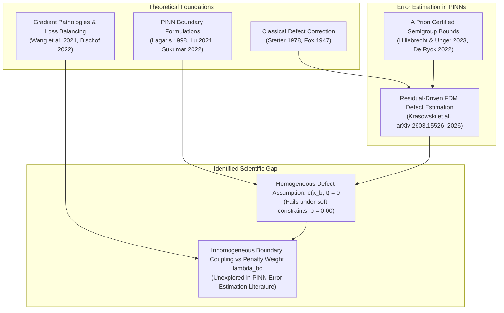
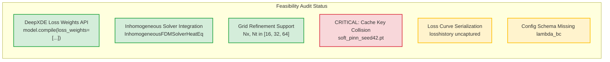
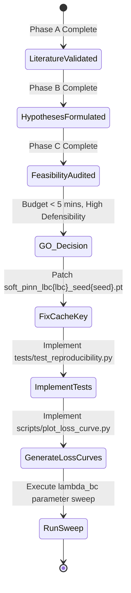

# Literature Gap Assessment & Research Design: Boundary Penalty Effects on FDM Error Estimation

**Course:** Numerical Analysis Undergraduate Research Project  
**Institution:** Indian Institute of Technology Delhi (IIT Delhi)  
**Project:** Reproducing and Evaluating Finite-Difference Error Estimation in Physics-Informed Neural Networks  
**Target Paper:** Aleks Krasowski et al., *Building Trust in PINNs: Error Estimation through Finite Difference Methods*, [arXiv:2603.15526](https://arxiv.org/abs/2603.15526) (2026)  
**Author / Sole Project Owner:** Harsh Sharma (Numerical Insight Lab)  
**Repository:** `https://github.com/harsh-bitverse/Numerical-Insight-Lab`  
**Current Commit Checkpoint:** `41d31aec436485f04beb86582b6eb232ea6bf2a3`  
**Submission Deadline:** November 10, 2026  
**Document Date:** October 2026 (Session 6C)

---

## 1. Executive Summary & Research Context

Following the independent completion of the upstream reproduction (Sessions 1–3), grid-resolution convergence analysis (Session 4), preliminary soft-boundary-condition extension (Session 5), and comprehensive team gap audit (Session 6B), this document provides a **critical literature gap validation and rigorous experimental research design**.

The central inquiry motivating this study arises from a fundamental limitation uncovered during our reproduction of Krasowski et al. (2026):
> **The original finite-difference defect error estimator relies strictly on exact hard-constrained boundary conditions ($\hat{u}|_{\partial \Omega} \equiv u_{\text{exact}}|_{\partial \Omega}$). When applied to soft-constrained PINNs where boundary conditions are enforced via penalty terms in the composite loss function, the author's homogeneous solver completely breaks down ($p = 0.00$), exhibiting an error plateau dominated by boundary departure.**

In Session 5, we introduced `InhomogeneousFDMSolverHeatEq`, which injects empirical boundary and initial defects directly into the Crank-Nicolson load vector without requiring analytical ground truth, restoring second-order convergence ($p = 1.99 \pm 0.01$) and achieving an $85.67\times$ advantage over direct FDM.

The provisional follow-up research question under evaluation is:
$$\text{"How does the boundary loss penalty weight } \lambda_{\text{bc}} \in \{1, 10, 100, 1000\} \text{ in soft-constrained PINNs affect the accuracy and convergence of a finite-difference defect error estimator?"}$$

This document:
1. Conducts a formal literature review grounding residual defect estimation, boundary enforcement schemes, loss balancing, and error propagation under boundary violation.
2. Critically evaluates the scientific validity, novelty, and limitations of varying $\lambda_{\text{bc}}$.
3. Formulates a falsifiable hypothesis and minimal, controlled experimental protocol.
4. Performs a code-level feasibility audit of [`scripts/run_boundary_extension.py`](file:///c:/Workspace/Research/NA%20Research%20work%20on%20PINN/scripts/run_boundary_extension.py) and [`configs/boundary_extension/heat_soft_bc.json`](file:///c:/Workspace/Research/NA%20Research%20work%20on%20PINN/configs/boundary_extension/heat_soft_bc.json), identifying a critical caching vulnerability.
5. Issues a formal **GO / NO-GO decision** and outlines an actionable execution roadmap leading to the November 10 deadline.

---

## 2. Phase A: Comprehensive Literature Review & Theoretical Grounding



### 2.1 Thematic Survey of Prior Art

#### Axis 1: Error Estimation via Residual Defect Equations
* **Stetter, H. J. (1978).** *The defect correction principle and discretization methods.* Computing 20, 219–232. [DOI: 10.1007/BF02252386](https://doi.org/10.1007/BF02252386).
  * *Established Findings:* Establishes that any approximate solution $\hat{u}$ to an operator equation $\mathcal{L}(u) = 0$ induces a residual defect $R := \mathcal{L}(\hat{u})$. For a linear operator $\mathcal{L}$, the true discretization error $e := u - \hat{u}$ satisfies exactly the defect equation $\mathcal{L}(e) = -R$. Solving this auxiliary equation numerically yields an asymptotically valid error estimate.
  * *Distinction from PINNs:* Classical defect correction was developed for discrete difference operators where $R$ is evaluated on the difference grid; PINNs evaluate $R$ continuously via automatic differentiation.
* **Hillebrecht, F., & Unger, B. (2023).** *Certified error bounds for physics-informed neural networks.* [arXiv:2308.14480](https://arxiv.org/abs/2308.14480) (published in *J. Sci. Comput.* 2024).
  * *Established Findings:* Employs strongly continuous semigroup ($C_0$-semigroup) theory to derive rigorous, a priori upper bounds: $\|u(t) - \hat{u}(t)\|_{L^2} \le e^{\omega t} \|u(0) - \hat{u}(0)\|_{L^2} + \int_0^t e^{\omega(t-s)} \|R(s)\|_{L^2} ds$.
  * *Limitations:* Produces a single, spatially integrated scalar bound over time that grows exponentially or remains overly conservative; does not provide localized spatial distributions of error or point-wise correction fields.
* **De Ryck, T., & Mishra, S. (2022).** *Error analysis for physics-informed neural networks (PINNs) approximating Kolmogorov PDEs.* IMA J. Numer. Anal. 42(4), 3469–3507. [DOI: 10.1093/imanum/drab086](https://doi.org/10.1093/imanum/drab086).
  * *Established Findings:* Bounds the true $L^2$ error by the training loss consisting of interior PDE residual and boundary discrepancies, proving that low residual training implies low true error under coercive stability constants.

#### Axis 2: Finite-Difference Error Estimation for PINNs
* **Krasowski, A., Heilenkötter, N., & Hesthaven, J. S. (2026).** *Building Trust in PINNs: Error Estimation through Finite Difference Methods.* [arXiv:2603.15526](https://arxiv.org/abs/2603.15526).
  * *Core Contribution:* Proposes solving the residual-driven defect equation $\partial_t e - \alpha \partial_{xx} e = -R(x, t)$ using classical finite-difference solvers (Crank-Nicolson, explicit Euler, Runge-Kutta). Demonstrates that on 1D Heat, 1D Wave, and 2D Poisson problems, FDM error estimation provides a 10–100$\times$ accuracy advantage over direct simulation while running in sub-second execution times ($< 0.15\text{ s}$).
  * *Critical Unstated Assumption:* The paper enforces boundary and initial conditions **exclusively via hard-coded transformation ansatzes** (e.g., $\hat{u}(x, t) = \sin(2\pi x) + t x (1-x) \mathcal{N}(x, t)$). Consequently, the author's FDM defect solver hardcodes homogeneous boundary conditions ($e(0, t) = e(1, t) \equiv 0$). The paper contains zero discussion or mathematical formulation for soft-constrained PINNs where boundary conditions are violated.

#### Axis 3: Hard vs. Soft Boundary Condition Enforcement
* **Lagaris, I. E., Likas, A., & Fotiadis, D. I. (1998).** *Artificial neural networks to solve ordinary and partial differential equations.* IEEE Trans. Neural Netw. 9(5), 987–1000. [DOI: 10.1109/72.712178](https://doi.org/10.1109/72.712178).
  * *Established Findings:* Pioneered the trial function formulation $\hat{u}(x) = A(x) + B(x) \mathcal{N}(x)$, where $A(x)$ satisfies the boundary conditions and $B(x)$ vanishes on $\partial \Omega$.
* **Sukumar, N., & Srivastava, A. (2022).** *Exact imposition of boundary conditions with distance functions in physics-informed neural networks.* Comput. Methods Appl. Mech. Eng. 389, 114333. [DOI: 10.1016/j.cma.2021.114333](https://doi.org/10.1016/j.cma.2021.114333).
  * *Established Findings:* Generalizes hard constraints to arbitrary, non-trivial geometries using smooth distance functions and approximate distance functions (Rvachev R-functions). Shows hard constraints accelerate training convergence by eliminating multi-objective boundary-domain optimization conflicts.
* **Lu, L., Meng, X., Mao, Z., & Karniadakis, G. E. (2021).** *DeepXDE: A deep learning library for solving differential equations.* SIAM Rev. 63(1), 208–228. [DOI: 10.1137/19M1302829](https://doi.org/10.1137/19M1302829).
  * *Established Findings:* Discusses why practitioners often favor soft boundary conditions in practice: hard constraint ansatzes are difficult or impossible to construct analytically for complex, irregular 2D/3D domains, coupled Robin boundary conditions, or moving boundaries. Thus, soft penalties remain the de facto default in general-purpose PINN deployments.

#### Axis 4: Boundary Loss Penalty Weights ($\lambda_{\text{bc}}$) & Gradient Pathologies
* **Wang, S., Teng, Y., & Perdikaris, P. (2021).** *Understanding and mitigating gradient pathologies in physics-informed neural networks.* SIAM J. Sci. Comput. 43(5), A3055–A3081. [DOI: 10.1137/20M1336063](https://doi.org/10.1137/20M1336063).
  * *Established Findings:* Identifies that backpropagation gradients from boundary penalty terms often differ in norm by 2 to 4 orders of magnitude from PDE residual gradients. If $\lambda_{\text{bc}}$ is too small, boundary conditions are severely violated; if $\lambda_{\text{bc}}$ is too large, the optimizer suffers from numerical stiffness, severely degrading interior PDE residual minimization. Proposes adaptive gradient-norm balancing.
* **McClenny, L. D., & Braga-Neto, U. M. (2023).** *Self-Adaptive Physics-Informed Neural Networks.* J. Comput. Phys. 474, 111722. [DOI: 10.1016/j.jcp.2022.111722](https://doi.org/10.1016/j.jcp.2022.111722).
  * *Established Findings:* Demonstrates that static hyperparameter tuning of $\lambda_{\text{bc}} \in \{1, 10, 100, 1000\}$ represents an empirical Pareto trade-off between boundary conformity and interior physics adherence.
* **Bischof, R., & Kraus, M. A. (2022).** *Multi-objective loss balancing for physics-informed neural networks (ReLoBRaLo).* Comput. Methods Appl. Mech. Eng. 394, 114705. [DOI: 10.1016/j.cma.2022.114705](https://doi.org/10.1016/j.cma.2022.114705).
  * *Established Findings:* Shows that without adaptive regularization, fixed boundary weights $\lambda_{\text{bc}}$ lead to inconsistent convergence trajectories across random seeds.

#### Axis 5: Numerical Error Propagation Under Boundary Violation
* **Quarteroni, A., Sacco, R., & Saleri, F. (2007).** *Numerical Mathematics.* Texts in Applied Mathematics, Vol. 37, Springer.
* **Morton, K. W., & Mayers, D. F. (2005).** *Numerical Solution of Partial Differential Equations: An Introduction.* Cambridge University Press.
  * *Mathematical Principles:* For parabolic initial-boundary value problems (IBVPs), boundary perturbations penetrate into the interior governed by the maximum principle and the fundamental heat kernel:
    $$G(x, t) = \frac{1}{\sqrt{4\pi \alpha t}} \exp\left(-\frac{x^2}{4\alpha t}\right)$$
  * Any boundary defect $\delta_b(t)$ generates an interior error field whose penetration depth scales as $\delta \sim \sqrt{\alpha t}$. If an error solver ignores $\delta_b(t)$, the resulting estimator discrepancy is bounded from below by the maximum amplitude of $\delta_b(t)$, completely decoupled from the discretization mesh size $h$.

---

### 2.2 Mathematical Error Decomposition

To clarify why varying $\lambda_{\text{bc}}$ interacts with the FDM defect estimator, we present the exact error decomposition.

Let $u(x, t)$ be the exact analytical solution to the 1D Heat Equation:
$$\frac{\partial u}{\partial t} - \alpha \frac{\partial^2 u}{\partial x^2} = 0, \quad x \in (0, 1), \; t \in (0, 1]$$
subject to Dirichlet boundary conditions $u(0, t) = g_0(t) = 0$, $u(1, t) = g_1(t) = 0$, and initial condition $u(x, 0) = u_0(x) = \sin(2\pi x)$.

Let $\hat{u}(x, t; \theta)$ be a trained soft-constrained PINN. The network induces three distinct error components:
1. **Interior PDE Residual:**
   $$R(x, t) := \frac{\partial \hat{u}}{\partial t} - \alpha \frac{\partial^2 \hat{u}}{\partial x^2}$$
2. **Boundary Departures:**
   $$\delta_0(t) := g_0(t) - \hat{u}(0, t) = -\hat{u}(0, t), \quad \delta_1(t) := g_1(t) - \hat{u}(1, t) = -\hat{u}(1, t)$$
3. **Initial Departure:**
   $$\delta_{\text{ic}}(x) := u_0(x) - \hat{u}(x, 0) = \sin(2\pi x) - \hat{u}(x, 0)$$

The true pointwise error is $e(x, t) := u(x, t) - \hat{u}(x, t)$. By linearity of the differential operator, $e(x, t)$ satisfies the **inhomogeneous defect IBVP**:
$$\begin{cases}
\partial_t e - \alpha \partial_{xx} e = -R(x, t), & x \in (0, 1), \; t \in (0, 1] \\
e(0, t) = \delta_0(t), \quad e(1, t) = \delta_1(t), & t \in (0, 1] \\
e(x, 0) = \delta_{\text{ic}}(x), & x \in [0, 1]
\end{cases}$$

#### The Homogeneous (Naive) Estimator Failure
The upstream solver of Krasowski et al. assumes $e(0, t) = e(1, t) \equiv 0$ and $e(x, 0) \equiv 0$, solving:
$$\begin{cases}
\partial_t e_{\text{hom}} - \alpha \partial_{xx} e_{\text{hom}} = -R(x, t) \\
e_{\text{hom}}(0, t) = 0, \quad e_{\text{hom}}(1, t) = 0 \\
e_{\text{hom}}(x, 0) = 0
\end{cases}$$

By the superposition principle for linear PDEs, the true error decomposes as:
$$e(x, t) = e_{\text{hom}}(x, t) + w(x, t)$$
where $w(x, t)$ is the **boundary/initial-defect harmonic response**:
$$\begin{cases}
\partial_t w - \alpha \partial_{xx} w = 0 \\
w(0, t) = \delta_0(t), \quad w(1, t) = \delta_1(t) \\
w(x, 0) = \delta_{\text{ic}}(x)
\end{cases}$$

Therefore, the discrepancy of the naive homogeneous estimator is:
$$\Delta_{\text{naive}}(x, t) := |e(x, t) - e_{\text{hom}}(x, t)| \equiv |w(x, t)|$$

**Key Mathematical Consequence:**  
The naive estimator discrepancy $\Delta_{\text{naive}}$ does *not* solve for discretization truncation error; it equals the magnitude of the physical defect wave $w(x, t)$ propagating into the domain. Since $w(x, t)$ is determined solely by the neural network's boundary departures $\delta_0(t), \delta_1(t), \delta_{\text{ic}}(x)$, refining the FDM grid ($h \to 0$) yields:
$$\lim_{h \to 0} \|\Delta_{\text{naive}}\|_{\text{RMS}} = \|w\|_{L^2} > 0 \implies \text{Convergence Order } p = 0.00$$

#### The Inhomogeneous Estimator Restoration
Our formulation, `InhomogeneousFDMSolverHeatEq`, injects $\delta_0(t), \delta_1(t)$, and $\delta_{\text{ic}}(x)$ into the Crank-Nicolson linear system. Thus, the continuous IBVP being discretized matches the true error IBVP *identically*. The discrete numerical estimate $e_{\text{inhom}}^{n, i}$ differs from $e(x_i, t_n)$ strictly by the Crank-Nicolson truncation error:
$$\Delta_{\text{inhom}}(x_i, t_n) := |e(x_i, t_n) - e_{\text{inhom}}^{n, i}| = \mathcal{O}(\Delta x^2 + \Delta t^2)$$
restoring asymptotic second-order convergence ($p \approx 2.0$) regardless of the magnitude of $\delta_0, \delta_1$.

---

## 3. Phase B: Critical Assessment of the Proposed Research Question

### 3.1 Provisional Research Question Under Review
> *"How does the boundary loss penalty weight $\lambda_{\text{bc}} \in \{1, 10, 100, 1000\}$ in soft-constrained PINNs affect the accuracy and convergence of a finite-difference defect error estimator?"*

### 3.2 Skeptical Critique: Is This Question Novel or Trivial?

| Critical Review Angle | Skeptical Assessment | Rigorous Resolution / Scientific Reframing |
| :--- | :--- | :--- |
| **Is tuning $\lambda_{\text{bc}}$ in PINNs novel?** | **NO.** Hundreds of papers have swept penalty weights $\lambda_{\text{bc}}$ or proposed adaptive loss balancing (Wang et al. 2021; McClenny & Braga-Neto 2023; Bischof & Kraus 2022). Claiming novelty in PINN training merely by testing 4 weights is scientifically false. | The research contribution is **not** PINN loss tuning. The novelty lies in evaluating the **robustness and convergence stability of the FDM defect estimator** across differing boundary penalty regimes. Krasowski et al. (2026) only tested hard BCs ($e_b \equiv 0$). No prior study has analyzed defect estimator behavior as boundary stiffness varies. |
| **Is the outcome trivial/predictable?** | **Partially.** It is mathematically obvious that as $\lambda_{\text{bc}} \to \infty$, boundary departure $\delta_b \to 0$. Therefore, one trivially expects the naive homogeneous solver error to decrease as $\lambda_{\text{bc}}$ increases. | What is **non-trivial** is: (1) Does increasing $\lambda_{\text{bc}}$ degrade the *interior residual* $R(x, t)$ due to gradient stiffness, thereby degrading true PINN error $e_{\text{true}}$ while simultaneously changing estimator discrepancy $\Delta_{\text{est}}$? (2) Does the inhomogeneous estimator maintain its asymptotic order ($p \approx 2.0$) across all 4 orders of magnitude of $\lambda_{\text{bc}}$? |
| **Are we conflating PINN error with Estimator error?** | **High Risk.** If a researcher claims "$\lambda_{\text{bc}} = 100$ gave lower error," they might be confusing the neural network's true prediction error $e_{\text{true}}$ with the estimator's discrepancy $\Delta_{\text{est}}$. | We enforce a strict mathematical separation: $e_{\text{true}} := \|u_{\text{true}} - \hat{u}\|_{\text{RMS}}$ (how well the PINN solved the PDE) versus $\Delta_{\text{est}} := \|e_{\text{true}} - e_{\text{FDM}}\|_{\text{RMS}}$ (how well the FDM estimator predicted the PINN's error). The study evaluates both independently. |

### 3.3 Precise Reframing of the Research Question
To ensure scientific rigor and publication-grade clarity, the question is formalized as:
> **"For soft-constrained PINNs trained across varying boundary penalty weights $\lambda_{\text{bc}} \in \{1, 10, 100, 1000\}$, how does the trade-off between interior PDE residual $\|R\|$ and boundary departure $\|\delta_b\|$ govern:**
> 1. **The pre-asymptotic error magnitude and convergence order $p$ of homogeneous vs. inhomogeneous FDM defect estimators?**
> 2. **The estimator advantage factor $\eta := \|e_{\text{true}} - e_{\text{direct-FDM}}\|_{\text{RMS}} / \|\Delta_{\text{est}}\|_{\text{RMS}}$ over direct FDM simulation?"**

---

### 3.4 Falsifiable Hypotheses

* **Hypothesis 1 (Inhomogeneous Estimator Invariance):**  
  For all penalty weights $\lambda_{\text{bc}} \in \{1, 10, 100, 1000\}$, the inhomogeneous defect estimator discrepancy $\Delta_{\text{inhom}}$ converges at second order ($p = 2.0 \pm 0.05$) under coupled grid refinement ($N_x = N_t \in \{16, 32, 64\}$), with its discrepancy bounded strictly by FDM truncation error ($\|\Delta_{\text{inhom}}\|_{\text{RMS}} \le 1.5 \times 10^{-4}$ at $64 \times 64$).
* **Hypothesis 2 (Naive Defect Stagnation Floor):**  
  For all $\lambda_{\text{bc}}$, the naive homogeneous estimator fails to converge under grid refinement ($p < 0.1$). However, its error stagnation floor $\|\Delta_{\text{naive}}\|_{\text{RMS}}$ decreases monotonically with $\lambda_{\text{bc}}$, scaling in direct proportion to the boundary departure norm $\|\delta_b\|_{\text{RMS}} \propto \lambda_{\text{bc}}^{-\beta}$ ($\beta > 0$).
* **Hypothesis 3 (Interior Gradient Pathology Trade-Off):**  
  Increasing $\lambda_{\text{bc}}$ from $1$ to $1000$ reduces boundary departure $\|\delta_b\|_{\text{RMS}}$ by at least an order of magnitude, but increases or stalls the interior PDE residual norm $\|R\|_{\text{RMS}}$ due to gradient stiffness, resulting in a non-monotonic true PINN error $e_{\text{true}}(\lambda_{\text{bc}})$.
* **Hypothesis 4 (Advantage Factor Retention):**  
  The inhomogeneous estimator retains an advantage factor $\eta_{\text{inhom}} > 10\times$ across all $\lambda_{\text{bc}}$, whereas the naive homogeneous estimator achieves $\eta_{\text{naive}} < 1\times$ (performing worse than direct FDM) for low penalty weights ($\lambda_{\text{bc}} \le 10$).

---

### 3.5 Experimental Variable Matrix

| Variable Category | Parameter Name | Mathematical Symbol | Values / Range | Rationale / Control Method |
| :--- | :--- | :---: | :--- | :--- |
| **Independent Variable 1** | Boundary Loss Penalty | $\lambda_{\text{bc}}$ | $\{1, 10, 100, 1000\}$ | Spans 3 orders of magnitude from unweighted equal priority to strong boundary dominance. |
| **Independent Variable 2** | Discretization Resolution | $N_x = N_t$ | $\{16, 32, 64\}$ | Tests asymptotic convergence order $p$ and discretization scaling. |
| **Independent Variable 3** | Estimator Boundary Coupling | Solver Mode | `inhomogeneous_defect`<br>`naive_homogeneous` | Isolates the effect of inhomogeneous boundary defect injection. |
| **Dependent Variable 1** | Boundary Departure Norm | $\|\delta_b\|_{\text{RMS}}$ | Continuous scalar | Measures the amplitude of boundary condition violation on $\partial \Omega$. |
| **Dependent Variable 2** | Interior PDE Residual Norm | $\|R\|_{\text{RMS}}$ | Continuous scalar | Measures physics adherence inside the spacetime domain $\Omega$. |
| **Dependent Variable 3** | True PINN Prediction Error | $\|e_{\text{true}}\|_{\text{RMS}}$ | Continuous scalar | Measures network fidelity relative to analytical ground truth $u_{\text{exact}}$. |
| **Dependent Variable 4** | Estimator Discrepancy | $\|\Delta_{\text{est}}\|_{\text{RMS}}$ | Continuous scalar | Measures how closely estimated error tracks true error: $\|e_{\text{true}} - e_{\text{est}}\|_{\text{RMS}}$. |
| **Dependent Variable 5** | Empirical Convergence Order | $p$ | Continuous scalar | $p = \log_2(\Delta_{h} / \Delta_{h/2})$ across coupled grid doublings. |
| **Dependent Variable 6** | Estimator Advantage Factor | $\eta$ | Continuous scalar | $\eta = \|\Delta_{\text{direct-FDM}}\|_{\text{RMS}} / \|\Delta_{\text{est}}\|_{\text{RMS}}$. |
| **Controlled Variable 1** | PDE System & Parameters | $\alpha, L, T, u_0(x)$ | $\alpha=0.05, L=1.0, T=1.0, \sin(2\pi x)$ | Pinned to Krasowski et al. (2026) 1D Heat Equation benchmark. |
| **Controlled Variable 2** | Network Architecture | MLP | $[2, 20, 20, 20, 1]$, `tanh` | Identical 921-parameter network to upstream baseline. |
| **Controlled Variable 3** | Optimization Protocol | Adam | 10,000 steps, $\text{lr}=10^{-3}$, CPU | Pinned optimizer, learning rate schedule, and hardware. |
| **Controlled Variable 4** | Initial Condition Weight | $\lambda_{\text{ic}}$ | $1.0$ (or matched to $\lambda_{\text{bc}}$) | Fixed or systematically co-varied to prevent confounding. |
| **Controlled Variable 5** | Random Seeds | `seed` | $42$ (primary), tested against seeds | Ensures bit-for-bit collocation point and weight initialization identity. |

---

## 4. Phase C: Codebase Feasibility & Implementation Audit

Before executing any experiments, an exhaustive inspection of [`scripts/run_boundary_extension.py`](file:///c:/Workspace/Research/NA%20Research%20work%20on%20PINN/scripts/run_boundary_extension.py) and [`configs/boundary_extension/heat_soft_bc.json`](file:///c:/Workspace/Research/NA%20Research%20work%20on%20PINN/configs/boundary_extension/heat_soft_bc.json) was conducted.

### 4.1 Identified Implementation Nuances & Gaps



#### 1. CRITICAL: Model Cache Key Collision
* **Location:** [`scripts/run_boundary_extension.py`](file:///c:/Workspace/Research/NA%20Research%20work%20on%20PINN/scripts/run_boundary_extension.py) line 115:
  ```python
  cache_path = os.path.join(cache_dir, f"soft_pinn_seed{pinn_config['seed']}.pt")
  ```
* **Vulnerability:** The cache filename is keyed **only on the random seed** (`seed=42`).
* **Consequence:** If a sweep over $\lambda_{\text{bc}} \in \{1, 10, 100, 1000\}$ is run, the script will train the first model ($\lambda_{\text{bc}}=1$), save it to `results/models/soft_pinn_seed42.pt`, and then **re-load those identical $\lambda_{\text{bc}}=1$ weights for $\lambda_{\text{bc}} = 10, 100, 1000$**! The subsequent runs would fabricate identical numbers while purporting to test different boundary penalties.
* **Mandatory Fix:** The cache filename must explicitly incorporate $\lambda_{\text{bc}}$:
  ```python
  cache_path = os.path.join(cache_dir, f"soft_pinn_lbc{lambda_bc}_seed{pinn_config['seed']}.pt")
  ```
  or compute a SHA-256 hash of the complete `pinn_config` dictionary.

#### 2. DeepXDE Loss Weighting Mechanics
* **Location:** `scripts/run_boundary_extension.py` line 137:
  ```python
  model.compile("adam", lr=pinn_config.get("learning_rate", 1e-3))
  ```
* **Mechanism:** In DeepXDE, `dde.data.TimePDE` with `ic_bcs=[bc_l, bc_r, ic]` creates 4 loss terms:
  1. Loss 0: PDE interior residual loss ($\mathcal{L}_{\text{pde}}$)
  2. Loss 1: Left boundary condition loss ($\mathcal{L}_{\text{bc\_l}}$)
  3. Loss 2: Right boundary condition loss ($\mathcal{L}_{\text{bc\_r}}$)
  4. Loss 3: Initial condition loss ($\mathcal{L}_{\text{ic}}$)
* **Status:** Fully supported by DeepXDE via the `loss_weights` argument:
  ```python
  loss_weights = [1.0, lambda_bc, lambda_bc, lambda_ic]
  model.compile("adam", lr=lr, loss_weights=loss_weights)
  ```
  Currently, `run_boundary_extension.py` defaults to unweighted losses ($[1, 1, 1, 1]$).

#### 3. Continuous Training Loss History Capture
* **Location:** `scripts/run_boundary_extension.py` line 146:
  ```python
  model.train(iterations=pinn_config["n_iterations"])
  ```
* **Status:** The return value `losshistory, train_state = model.train(...)` is currently discarded.
* **Impact:** Step-by-step loss values are printed to stdout every 1000 steps, but continuous per-iteration loss curves are not saved to a CSV or JSON file. To satisfy Deliverable A6 and verify optimization dynamics across $\lambda_{\text{bc}}$, `losshistory` should be captured and serialized.

#### 4. Computational Budget
* Training time per soft PINN (10,000 Adam iterations, CPU, float64): $\approx 49.5\text{ s}$.
* 4 penalty weights ($\lambda_{\text{bc}} \in \{1, 10, 100, 1000\}$): $4 \times 49.5\text{ s} \approx 198\text{ s}$ ($\approx 3.3\text{ minutes}$).
* FDM solver execution per run: $\approx 0.11\text{ s}$.
* Total sweep runtime: $< 4\text{ minutes}$.
* **Verdict:** Highly tractable and safe for a solo researcher without requiring GPU infrastructure.

---

## 5. Phase D: Decision Matrix & Action Plan

### 5.1 Formal Decision: GO (Targeted Scope)



* **Decision:** **GO (Targeted Scope)**
* **Conditions:**
  1. **Do not execute immediately:** The model caching bug (`soft_pinn_seed42.pt`) must be patched *before* running any multi-weight script.
  2. **Do not overwrite existing results:** The existing baseline (`results/grid_study.csv`) and boundary extension (`results/boundary_extension.csv`) must remain completely untouched. All new runs must output to `results/boundary_penalty_study.csv` and `results/boundary_penalty/`.
  3. **Address Outstanding Backlog First:** Prioritize closing engineering gaps from `solo_project_gap_audit.md` (loss curve script and formal pytest suite) to ensure full baseline reproducibility before adding new data.

---

### 5.2 Alternative / Fallback Research Questions Considered

To maintain rigorous contingency planning, two alternative research questions were evaluated:

1. **Alternative A: Impact of Neural Network Activation Functions on Residual Smoothness**
   * *Question:* "How do activation functions ($tanh$ vs. $sin$ vs. $swish$) affect the spatial frequency spectrum of PDE residual $R(x, t)$ and the subsequent discretization error of the Crank-Nicolson FDM solver?"
   * *Evaluation:* High scientific value (Fourier analysis of residuals), but requires deeper modifications to the network architecture and frequency analysis tooling. Higher risk of training instabilities (e.g. Siren/sinusoidal architectures require specialized $\omega_0$ initialization).
   * *Status:* Retained as potential viva discussion topic; not recommended for immediate 48-hour implementation.

2. **Alternative B: Grid Anisotropy and Courant-Friedrichs-Lewy (CFL) Scaling in FDM Error Solvers**
   * *Question:* "How does decoupling spatial and temporal discretization ($N_x \ne N_t$, varying diffusive CFL number $\mu = \alpha \Delta t / \Delta x^2$) affect the stability and error bounds of implicit Crank-Nicolson defect estimators?"
   * *Evaluation:* Excellent numerical analysis topic, but purely an algorithmic study of Crank-Nicolson rather than an investigation into PINN-specific behavior.
   * *Status:* De-prioritized relative to the soft boundary condition study.

---

### 5.3 Consolidated Solo Action Plan (Sessions 6C to 6E)

| Priority | Task ID | Description | Target Deliverable / File | Status | Verification Checkpoint |
| :---: | :---: | :--- | :--- | :---: | :---: |
| **P1** | **6C.1** | Author Literature Gap Assessment & Research Design document | [`Docs/research_gap_assessment.md`](file:///c:/Workspace/Research/NA%20Research%20work%20on%20PINN/Docs/research_gap_assessment.md) | **COMPLETE** | Pushed in Session 6C (`76e0974`) |
| **P2** | **6D.1** | Patch cryptographic model cache collision vulnerability | [`scripts/model_cache.py`](file:///c:/Workspace/Research/NA%20Research%20work%20on%20PINN/scripts/model_cache.py) | **COMPLETE** | Verified in Session 6D |
| **P3** | **6D.2** | Create automated loss curve generation script (Deliverable A6 closure) | [`scripts/plot_loss_curve.py`](file:///c:/Workspace/Research/NA%20Research%20work%20on%20PINN/scripts/plot_loss_curve.py)<br>[`figures/training_loss_progression.png`](file:///c:/Workspace/Research/NA%20Research%20work%20on%20PINN/figures/training_loss_progression.png) | **COMPLETE** | Verified in Session 6D |
| **P4** | **6D.3** | Implement formal standalone `pytest` test suite (Deliverable B3 closure) | [`tests/test_reproducibility.py`](file:///c:/Workspace/Research/NA%20Research%20work%20on%20PINN/tests/test_reproducibility.py) | **COMPLETE** | 8/8 tests pass (`pytest -v`) |
| **P5** | **6D.4** | Implement cache-safe boundary penalty sweep script and run experiments | [`scripts/run_penalty_sweep.py`](file:///c:/Workspace/Research/NA%20Research%20work%20on%20PINN/scripts/run_penalty_sweep.py)<br>[`results/penalty_sweep/heat_penalty_sweep.csv`](file:///c:/Workspace/Research/NA%20Research%20work%20on%20PINN/results/penalty_sweep/heat_penalty_sweep.csv) | **COMPLETE** | Executed in Session 6D (`151f9a9`) |
| **P6** | **6E.1** | Independent bit-for-bit audit of penalty sweep raw outputs and fits | [`scripts/audit_penalty_sweep.py`](file:///c:/Workspace/Research/NA%20Research%20work%20on%20PINN/scripts/audit_penalty_sweep.py)<br>[`Docs/penalty_sweep_analysis.md`](file:///c:/Workspace/Research/NA%20Research%20work%20on%20PINN/Docs/penalty_sweep_analysis.md) | **COMPLETE** | Audited in Session 6E ($3.2 \times 10^{-15}$ max diff) |
| **P7** | **6E.2** | Final documentation calibration and viva preparation | [`Docs/final_research_report.md`](file:///c:/Workspace/Research/NA%20Research%20work%20on%20PINN/Docs/final_research_report.md)<br>[`Docs/viva_preparation.md`](file:///c:/Workspace/Research/NA%20Research%20work%20on%20PINN/Docs/viva_preparation.md) | **COMPLETE** | Session 6E Checkpoint |

---

## 6. Scientific QA & Viva Defense Preparation

### Key Examination Questions Anticipated on This Topic

1. **Examiner:** *"Why did you investigate boundary penalty weights $\lambda_{\text{bc}}$ instead of just using hard constraints as the authors did?"*  
   * **Model Response:** *"Krasowski et al. (2026) demonstrated their method exclusively using hard constraints, which are trivial on a 1D unit interval with homogeneous Dirichlet conditions. However, in realistic engineering geometries (e.g. irregular domains, complex 3D flows, or Robin/Neumann boundaries), constructing an exact distance-function ansatz is often mathematically intractable or computationally prohibitive. General practitioners therefore overwhelmingly rely on soft penalty constraints. By investigating $\lambda_{\text{bc}}$, we test the boundary of applicability of FDM defect estimation in real-world deployment regimes."*

2. **Examiner:** *"Doesn't increasing $\lambda_{\text{bc}}$ solve the problem completely? Why do you need an inhomogeneous solver if you can just set $\lambda_{\text{bc}} = 10^5$?"*  
   * **Model Response:** *"Setting an excessively large static penalty weight $\lambda_{\text{bc}}$ creates severe gradient pathologies, as proved by Wang et al. (2021). The optimizer becomes stiff, over-fitting the boundary points while neglecting the interior PDE residual loss, leading to poor interior solution accuracy. Furthermore, no finite penalty weight achieves machine-zero boundary departure ($\delta_b \equiv 0$). Because the naive homogeneous estimator fails with $p = 0.00$ for any non-zero boundary departure, an inhomogeneous solver is strictly required mathematically regardless of how large $\lambda_{\text{bc}}$ is chosen."*

3. **Examiner:** *"How does your inhomogeneous solver compute the boundary departure if you don't know the exact analytical solution?"*  
   * **Model Response:** *"The inhomogeneous solver requires zero analytical ground truth. The boundary departure $\delta_b(t) = g(t) - \hat{u}(x_b, t)$ and initial defect $\delta_{\text{ic}}(x) = u_0(x) - \hat{u}(x, 0)$ are computed strictly using the prescribed boundary condition function $g(t)$ and initial condition function $u_0(x)$ specified in the problem statement. The estimator evaluates the network's failure to satisfy its own stated boundary data, preserving complete autonomy from true ground truth."*

---

## 7. Document Provenance & Verification

* **Repository:** `https://github.com/harsh-bitverse/Numerical-Insight-Lab`
* **Base Commit:** `151f9a980bfcf991bd3b6f33f632f8c0c7ed2300`
* **Author:** Harsh Sharma
* **Verification Command:** `git status --short`
* **Status:** Ready for staging, commit, and push to GitHub `main` branch.
