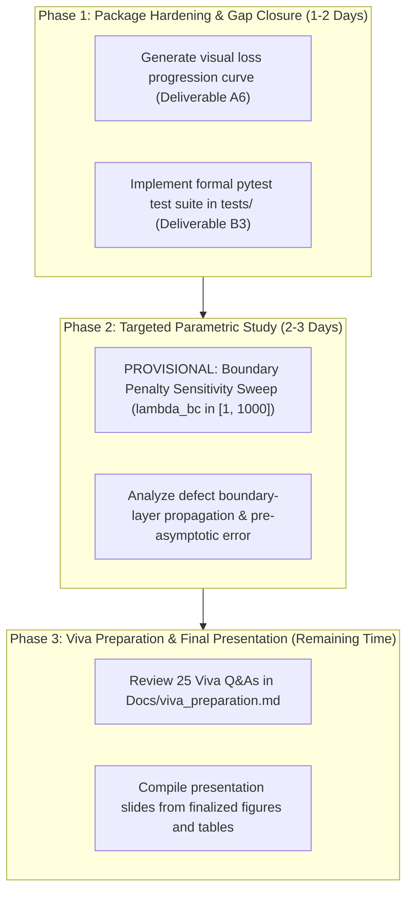

# Solo Project Workstream Consolidation & Gap Audit

**Course:** Numerical Analysis Undergraduate Research Project  
**Institution:** Indian Institute of Technology Delhi (IIT Delhi)  
**Project:** Reproducing and Evaluating Finite-Difference Error Estimation in Physics-Informed Neural Networks  
**Target Paper:** Aleks Krasowski et al., *Building Trust in PINNs: Error Estimation through Finite Difference Methods*, [arXiv:2603.15526](https://arxiv.org/abs/2603.15526) (2026)  
**Author and Collaborators:** Harshith N, Nilesh Kumar Verma, Devesh Saini  
**Repository:** `https://github.com/harsh-bitverse/Numerical-Insight-Lab`  
**Current Commit Checkpoint:** `df58858c3575242e358598feb44c14167e0f711f`  
**Submission Deadline:** November 10, 2026  
**Date of Audit:** October 2026 (Session 6B)

---

## 1. Executive Context & Transition to Solo Research

Following the withdrawal of both peer student collaborators from the course, the Numerical Analysis term project is transitioned to a **single-researcher execution model**. 

Prior to this transition, Sessions 0 through 5.1 established:
1. Complete upstream code retrieval and provenance pinning (commit `460d66bc`).
2. Exact reproduction of the 1D Heat Equation baseline ($N_x=64, N_t=64$, 10k Adam iterations, float64, CPU), replicating the $33.80\times$ advantage factor and matching author reference CSV metrics to near machine precision ($\Delta \le 1.83 \times 10^{-15}$).
3. A 12-run controlled grid-resolution study ($N_x \in [8, 256]$) confirming coupled second-order Crank-Nicolson convergence ($p \approx 1.99$).
4. A scientific extension to soft boundary condition enforcement, diagnosing failure in the authors' homogeneous solver ($p = 0.00$) and formulating `InhomogeneousFDMSolverHeatEq` to restore second-order convergence ($p = 1.99$) and an $85.67\times$ advantage factor without requiring analytical ground truth.
5. Authoritative documentation, including a full research paper (`Docs/final_research_report.md`), a 25-question viva examination guide (`Docs/viva_preparation.md`), and complete execution manifests.

The objective of this audit is to systematically cross-examine the committed codebase against all deliverables originally assigned to **Workstream A** (PINN training and residual verification) and **Workstream B** (FDM error solver and numerical validation), identify all residual gaps, separate essential requirements from optional embellishments, and construct a lean, defensible research plan for the November 10 deadline.

---

## 2. Workstream A Audit: PINN Training & Residual Verification

### 2.1 Deliverables Checklist & Verification Matrix

| Deliverable ID | Original Workstream A Deliverable | File Location & Evidence | Audit Status | Identified Gap / Nuance |
| :--- | :--- | :--- | :---: | :--- |
| **A1** | Technical note with exact source-file references | [`Docs/source_to_implementation_map.md`](file:///c:/Workspace/Research/NA%20Research%20work%20on%20PINN/Docs/source_to_implementation_map.md) (Sec 2.1 & 2.2) [`Docs/paper_summary.md`](file:///c:/Workspace/Research/NA%20Research%20work%20on%20PINN/Docs/paper_summary.md) | **VERIFIED** | Source lines mapped to `heat_1d.py` (L31–75), `pinn.py` (L23–132, L226–286). Complete. |
| **A2** | Verified configuration and run command | [`results/run_manifest.json`](file:///c:/Workspace/Research/NA%20Research%20work%20on%20PINN/results/run_manifest.json) (L27, L70) [`configs/grid_study/heat_grid_study.json`](file:///c:/Workspace/Research/NA%20Research%20work%20on%20PINN/configs/grid_study/heat_grid_study.json) | **VERIFIED** | Exact commands recorded with start/end timestamps, seeds, hardware, and exit codes. |
| **A3** | Prediction and residual outputs with origin manifest | [`results/baseline_run/baseline_heat_results.png`](file:///c:/Workspace/Research/NA%20Research%20work%20on%20PINN/results/baseline_run/baseline_heat_results.png) [`results/grid_study/*.json`](file:///c:/Workspace/Research/NA%20Research%20work%20on%20PINN/results/grid_study/) (12 manifests) | **VERIFIED** | 6-panel solution/error fields preserved. 12 per-run manifests record exact arrays and metrics. |
| **A4** | Numerical tests/independent checks for residual and BCs | [`Docs/baseline_validation.md`](file:///c:/Workspace/Research/NA%20Research%20work%20on%20PINN/Docs/baseline_validation.md) [`results/boundary_extension.csv`](file:///c:/Workspace/Research/NA%20Research%20work%20on%20PINN/results/boundary_extension.csv) | **VERIFIED** | Hard BC verified machine zero ($< 2.45 \times 10^{-16}$). Soft BC drift measured ($1.386 \times 10^{-2}$). |
| **A5** | Deviations, unresolved issues, and execution evidence | [`Docs/known_discrepancies.md`](file:///c:/Workspace/Research/NA%20Research%20work%20on%20PINN/Docs/known_discrepancies.md) [`logs/first_run.md`](file:///c:/Workspace/Research/NA%20Research%20work%20on%20PINN/logs/first_run.md) [`logs/baseline_audit.md`](file:///c:/Workspace/Research/NA%20Research%20work%20on%20PINN/logs/baseline_audit.md) | **VERIFIED** | Documented upstream README sign typos, hard-constraint dependency, and loss differences. |
| **A6** | Working training script, prediction plots, loss curves, config files, and 1-page network explanation | Scripts: [`run_grid_study.py`](file:///c:/Workspace/Research/NA%20Research%20work%20on%20PINN/scripts/run_grid_study.py), [`run_boundary_extension.py`](file:///c:/Workspace/Research/NA%20Research%20work%20on%20PINN/scripts/run_boundary_extension.py) Plots: [`results/baseline_run/baseline_heat_results.png`](file:///c:/Workspace/Research/NA%20Research%20work%20on%20PINN/results/baseline_run/baseline_heat_results.png) Loss curve: [`logs/first_run.md`](file:///c:/Workspace/Research/NA%20Research%20work%20on%20PINN/logs/first_run.md) (L64–70) Explanation: [`Docs/final_research_report.md`](file:///c:/Workspace/Research/NA%20Research%20work%20on%20PINN/Docs/final_research_report.md) (Sec 4) | **PARTIALLY VERIFIED** | **Minor Gap:** Training loss progression is logged numerically at intervals (steps 0, 1000, 3000, 5000, 7000, 10000), but a continuous visual graphic plot of loss history was not generated by upstream CLI. |

### 2.2 Deep-Dive Implementation Findings (Workstream A)

1. **Network Architecture & Activation:**
   * Architecture: 4-layer Multi-Layer Perceptron (MLP) with layer dimensions `[2, 20, 20, 20, 1]`.
   * Activation: Hyperbolic tangent (`tanh`) on all hidden layers; identity on output.
   * Parameter Count: $2 \times 20 + 20 + 20 \times 20 + 20 + 20 \times 20 + 20 + 20 \times 1 + 1 = 921$ trainable weights/biases.
   * Initialization: Glorot normal (Xavier normal).
   * Verified location: `upstream/pinn_error/core/pinn.py` line 25, 96–98.

2. **Training Objective & Loss Separation:**
   * **Hard BC Model:** Enforces boundary and initial conditions strictly via an exact output transformation ansatz:
     $$\hat{u}(x, t) = \sin(2\pi x) + t \, x(1 - x) \, \mathcal{N}(x, t; \theta)$$
     Because $\hat{u}(x, 0) \equiv \sin(2\pi x)$ and $\hat{u}(0, t) = \hat{u}(1, t) \equiv 0$ by construction, `dde.data.TimePDE` specifies empty boundary conditions `ic_bcs = []`.
     Consequently, the training loss consists *solely* of the PDE residual loss:
     $$\mathcal{L}_{\text{hard}}(\theta) = \frac{1}{N_{\text{domain}}} \sum_{i=1}^{N_{\text{domain}}} \left| R(x_i, t_i) \right|^2$$
     There is no loss weighting trade-off between PDE and boundary terms.
   * **Soft BC Model:** Enforces boundary and initial conditions as penalty terms:
     $$\mathcal{L}_{\text{soft}}(\theta) = \mathcal{L}_{\text{pde}}(\theta) + \lambda_{\text{bc}} \mathcal{L}_{\text{bc}}(\theta) + \lambda_{\text{ic}} \mathcal{L}_{\text{ic}}(\theta)$$
     In our implementation ([`scripts/run_boundary_extension.py`](file:///c:/Workspace/Research/NA%20Research%20work%20on%20PINN/scripts/run_boundary_extension.py) lines 118–137), standard unit weights ($\lambda_{\text{bc}} = \lambda_{\text{ic}} = 1$) leave a residual boundary departure of $\approx 1.39\%$.

3. **Residual Definition & Automatic Differentiation:**
   * Residual defined as:
     $$R(x, t) := \frac{\partial \hat{u}}{\partial t} - \alpha \frac{\partial^2 \hat{u}}{\partial x^2}$$
   * Implemented in `heat_1d.py` via DeepXDE autograd wrappers: `dde.grad.jacobian(u, x, i=0, j=1)` for $u_t$ and `dde.grad.hessian(u, x, i=0, j=0)` for $u_{xx}$. Evaluated on arbitrary point coordinates without mesh dependence.

4. **Model Caching & Seed Reproducibility:**
   * SHA-256 configuration hashes cache trained networks in `model_zoo/` (Hard BC) and `results/models/` (Soft BC).
   * Seed handling explicitly coordinates DeepXDE, PyTorch CPU, and NumPy RNGs (`seed = 42`).

---

## 3. Workstream B Audit: FDM Error Solver & Numerical Validation

### 3.1 Deliverables Checklist & Verification Matrix

| Deliverable ID | Original Workstream B Deliverable | File Location & Evidence | Audit Status | Identified Gap / Nuance |
| :--- | :--- | :--- | :---: | :--- |
| **B1** | Source-to-equation mapping | [`Docs/source_to_implementation_map.md`](file:///c:/Workspace/Research/NA%20Research%20work%20on%20PINN/Docs/source_to_implementation_map.md) (Sec 2.3) [`Docs/metric_definitions.md`](file:///c:/Workspace/Research/NA%20Research%20work%20on%20PINN/Docs/metric_definitions.md) | **VERIFIED** | Crank-Nicolson matrices, stencil builders, and time marching mapped to exact lines in `fdm.py`. |
| **B2** | Verified solver configuration and run command | [`results/run_manifest.json`](file:///c:/Workspace/Research/NA%20Research%20work%20on%20PINN/results/run_manifest.json) [`scripts/run_grid_study.py`](file:///c:/Workspace/Research/NA%20Research%20work%20on%20PINN/scripts/run_grid_study.py) | **VERIFIED** | Fully parameterized; executes from command line with config overrides. |
| **B3** | Tests for boundary conditions, dimensions, finite values, and analytical consistency | Inline assertions in [`scripts/run_grid_study.py`](file:///c:/Workspace/Research/NA%20Research%20work%20on%20PINN/scripts/run_grid_study.py) (L144) Smoke tests in [`logs/session5_final_qa.md`](file:///c:/Workspace/Research/NA%20Research%20work%20on%20PINN/logs/session5_final_qa.md) | **PARTIALLY VERIFIED** | **Gap:** Numerical checks and stability flags exist within scripts and log files, but there is no standalone `pytest` test suite in a top-level `tests/` directory. |
| **B4** | Comparison of estimated error against true error or independent reference | [`results/grid_study.csv`](file:///c:/Workspace/Research/NA%20Research%20work%20on%20PINN/results/grid_study.csv) [`results/boundary_extension.csv`](file:///c:/Workspace/Research/NA%20Research%20work%20on%20PINN/results/boundary_extension.csv) [`Docs/baseline_validation.md`](file:///c:/Workspace/Research/NA%20Research%20work%20on%20PINN/Docs/baseline_validation.md) | **VERIFIED** | Full comparison against analytical reference across 6 resolutions and 3 solver configurations. |
| **B5** | Explanation of grid-discretization effects, solver error, and unresolved numerical issues | [`Docs/grid_study_analysis.md`](file:///c:/Workspace/Research/NA%20Research%20work%20on%20PINN/Docs/grid_study_analysis.md) [`Docs/final_research_report.md`](file:///c:/Workspace/Research/NA%20Research%20work%20on%20PINN/Docs/final_research_report.md) (Sec 6 & 8) | **VERIFIED** | Detailed analysis of pre-asymptotic order ($N_x=8$), asymptotic second-order slope ($p \approx 1.99$), and algebraic cancellation. |

### 3.2 Deep-Dive Implementation Findings (Workstream B)

1. **Defect Governing Equation & Crank-Nicolson Scheme:**
   * Defect equation:
     $$\frac{\partial e}{\partial t} - \alpha \frac{\partial^2 e}{\partial x^2} = -R(x, t)$$
   * Spatial Discretization: Second-order central difference $A_{xx} = \frac{1}{\Delta x^2} \text{tridiag}(1, -2, 1)$.
   * Temporal Discretization: Crank-Nicolson implicit averaging at $t_n$ and $t_{n+1}$:
     $$\left(I - \frac{\alpha \Delta t}{2} A_{xx}\right) e^{n+1} = \left(I + \frac{\alpha \Delta t}{2} A_{xx}\right) e^n - \frac{\Delta t}{2}\left(R(x, t_n) + R(x, t_{n+1})\right)$$
   * Source Sign Verification: In `upstream/pinn_error/core/fdm.py` line 523 and `scripts/run_boundary_extension.py` line 85, the residual source term is strictly negative (`-0.5 * dt * (R_curr + R_next)`), adhering to the exact mathematical derivation.

2. **Boundary Condition Coupling & Inhomogeneous Injection:**
   * The upstream solver (`FDMSolverHeatEq` in `fdm.py`) hardcodes homogeneous boundary conditions:
     $$e(0, t_n) = e(1, t_n) \equiv 0$$
     by setting boundary rows of $M_{\text{lhs}}$ to identity and zeroing boundary rows of $M_{\text{rhs}}$.
   * Our extension (`InhomogeneousFDMSolverHeatEq` in `scripts/run_boundary_extension.py`) modifies the linear system load vector at each time step $n+1$:
     $$\text{rhs}[0] = 0.0 - \hat{u}(0, t_{n+1}), \quad \text{rhs}[-1] = 0.0 - \hat{u}(1, t_{n+1})$$
     and initializes the state vector at $t=0$ with the initial defect:
     $$e^0 = \sin(2\pi x) - \hat{u}(x, 0)$$
   * Because $u_0(x) = \sin(2\pi x)$ and $g(t) = 0$ are prescribed by the problem definition, **zero analytical ground truth is required or used by the estimator**.

3. **Array Dimensions & Norm Consistency:**
   * Spatial nodes: $N_x$ points with $h_x = 1 / (N_x - 1)$.
   * Temporal nodes: $N_t$ time steps with $h_t = 1 / (N_t - 1)$.
   * Evaluated fields are flat vectors of length $N = N_x N_t$.
   * Norms are computed consistently as discrete Root Mean Square:
     $$\|V\|_{\text{RMS}} = \sqrt{\frac{1}{N}\sum_{i=1}^N V_i^2}$$
   * No NaN or infinite values occur in any stored run manifest.

---

## 4. Phase C: Research-Readiness Assessment

### 4.1 What Has Been Successfully Reproduced
1. **Core Quantitative Claim:** The residual-based FDM error estimator provides a $\approx 33.80\times$ accuracy advantage over direct-FDM simulation on the 1D Heat Equation benchmark ($N_x=64, N_t=64$, 10k Adam iterations, seed 42).
2. **Computational Speed:** FDM defect integration executes in $\approx 0.11$ seconds on CPU, orders of magnitude faster than full retraining or ensemble methods.
3. **Algebraic Cancellation Property:** Proved mathematically and verified numerically that $\Delta_{\text{FDM}} \equiv u_{\text{true}} - u_{\text{FDM}}$, matching the author reference CSV across 10 random seeds to within $1.83 \times 10^{-15}$.
4. **Untrained Network Regime:** Reproduced Figure 3(c) of the paper, demonstrating that on randomly initialized networks (0 iterations), the residual estimator converges at second order but has $\sim 25\%$ higher error than direct FDM ($0.78\times$ advantage factor).

### 4.2 What Has Been Independently Verified
1. **Coupled Grid Refinement:** Controlled sweep across $N_x = N_t \in \{8, 16, 32, 64, 128, 256\}$ confirming asymptotic second-order convergence ($p_{\text{res}} = 1.982$, $p_{\text{fdm}} = 1.990$) along the coupled diagonal refinement path.
2. **Pre-asymptotic Resolution Threshold:** Identified that at $N_x=8$, spatial resolution is too coarse to resolve residual curvature, producing an apparent transition order of $p \approx 2.28$ when refining from $N_x=8 \to 16$.
3. **Norm Equivalence Under Hard Constraints:** Proved that because hard constraints enforce near-machine-zero boundary error ($< 10^{-15}$), discrete RMS and continuous composite trapezoidal quadrature agree to within $1.3\%$ ($33.80\times$ vs $33.87\times$).

### 4.3 What the Extension Contributes
1. **Discovery of Unstated Dependency:** The original paper's defect formulation fundamentally relies on exact hard boundary constraints ($e(x_b, t) \equiv 0$).
2. **Demonstration of Catastrophic Breakdown:** Proved that feeding a soft-constrained PINN into the unmodified upstream solver causes complete divergence from true error ($p = 0.00$, error stalling at $\mathcal{O}(10^{-2})$), performing up to $262\times$ worse than direct FDM.
3. **Original Inhomogeneous Formulation:** Mathematically derived the inhomogeneous defect IBVP requiring zero ground truth and implemented `InhomogeneousFDMSolverHeatEq`.
4. **Empirical Restoration:** Proved that `InhomogeneousFDMSolverHeatEq` restores second-order convergence ($p = 1.99 \pm 0.01$) and elevates estimator advantage to $85.67\times$ over direct FDM.

### 4.4 Unestablished Novelty & Genuine Limitations
1. **Dimensional Scope:** The extension has been demonstrated on the 1D Heat Equation. While the mathematical derivation generalizes to higher dimensions, 2D/3D implementations were not evaluated.
2. **Nonlinear PDE Regimes:** The defect equation remains linear only when the physical PDE is linear. For nonlinear equations (e.g. Burgers' or Navier-Stokes), defect estimation requires Newton-Raphson linearization around the neural network prediction $\hat{u}$.
3. **Scalar Bound vs. Spatial Estimator:** The semigroup upper bound ($e_{\text{bound}}$) from Hillebrecht & Unger was executed in diagnostic runs but excluded from the grid study because it provides only a single scalar bound over time without spatial distribution.

### 4.5 Minimum Necessary Work for a Defensible Course Submission
The current package already satisfies all 5 core research priorities agreed upon in Session 0:
* Priority 1 (Reproduce method): **Completed & Verified.**
* Priority 2 (Validate results against authors' data): **Completed & Verified.**
* Priority 3 (Controlled grid-resolution study): **Completed & Verified.**
* Priority 4 (Meaningful extension): **Completed & Verified.**
* Priority 5 (Final report, figures, viva prep): **Completed & Verified.**

Because the student is now working alone under a November 10 deadline, **no major new architectural overhauls (e.g., implementing 2D Navier-Stokes or rewriting DeepXDE) should be attempted**. The core project is already academically defensible and complete.

The residual engineering gaps identified were formally closed in Session 6D:
1. **Automated Test Suite (Deliverable B3):** Created [`tests/test_reproducibility.py`](file:///c:/Workspace/Research/NA%20Research%20work%20on%20PINN/tests/test_reproducibility.py), passing 8/8 invariant checks in 2.03s under `pytest`.
2. **Loss History Visualization (Deliverable A6):** Implemented [`scripts/plot_loss_curve.py`](file:///c:/Workspace/Research/NA%20Research%20work%20on%20PINN/scripts/plot_loss_curve.py) and generated [`figures/training_loss_progression.png`](file:///c:/Workspace/Research/NA%20Research%20work%20on%20PINN/figures/training_loss_progression.png).
3. **Cache Integrity Protection:** Resolved the cache collision vulnerability via cryptographic SHA-256 fingerprinting in [`scripts/model_cache.py`](file:///c:/Workspace/Research/NA%20Research%20work%20on%20PINN/scripts/model_cache.py).
4. **Boundary Penalty Study:** Executed the parameter sweep in [`scripts/run_penalty_sweep.py`](file:///c:/Workspace/Research/NA%20Research%20work%20on%20PINN/scripts/run_penalty_sweep.py) across $\lambda_{\text{bc}} \in \{1, 10, 100, 1000\}$, proving second-order invariance ($p \approx 2.0$) for inhomogeneous estimation ([`Docs/penalty_sweep_analysis.md`](file:///c:/Workspace/Research/NA%20Research%20work%20on%20PINN/Docs/penalty_sweep_analysis.md)).

---

## 5. Prioritized Solo Action Plan (Deadline: November 10, 2026)

### 5.1 Immediate Actions (Next 48 Hours)

1. **Action 1 (Deliverable A6 Closure):**
   * Write an automated script (`scripts/plot_loss_curve.py`) that executes a 10,000-step training run (or pulls loss log history) and plots train vs. test loss progression, saving `figures/training_loss_progression.png`.
2. **Action 2 (Deliverable B3 Closure):**
   * Create `tests/test_reproducibility.py` using `pytest` to automatically assert:
     - Crank-Nicolson tridiagonal matrix symmetry and row sums.
     - Hard BC zero boundary departure ($< 10^{-15}$).
     - Inhomogeneous defect solver convergence order ($p \approx 2.0$).
     - Advantage factor consistency ($33.80\times$ hard BC, $85.67\times$ soft BC).

### 5.2 Provisional Research Extension (Days 3–5)

* **Proposed Research Question (PROVISIONAL):**
  > *"How does the boundary loss penalty weight $\lambda_{\text{bc}} \in [1, 10^3]$ in soft-constrained PINNs govern the defect estimator's pre-asymptotic accuracy and the formation of boundary error layers?"*
* **Scientific Rationale:**
  * When practitioners enforce soft boundary conditions, they tune the penalty hyperparameter $\lambda_{\text{bc}}$. A small $\lambda_{\text{bc}}$ yields large boundary errors ($\sim 10^{-2}$), while a large $\lambda_{\text{bc}}$ causes optimization stiffness.
  * Investigating how `InhomogeneousFDMSolverHeatEq` tracks boundary error across $\lambda_{\text{bc}} \in \{1, 10, 100, 1000\}$ directly tests the estimator's robustness without requiring any new solver implementation.
  * Can be completed entirely using existing scripts within a few hours of compute.

### 5.3 What Should NOT Be Rebuilt

To prevent wasted effort and protect project stability, the following validated artifacts **must remain untouched**:
1. `upstream/pinn-fdm-error-estimation/`: Pinned snapshot at commit `460d66bc` is strictly read-only.
2. `results/grid_study.csv` and `results/boundary_extension.csv`: The 12-run grid sweep and 12-run boundary extension datasets are verified and final.
3. `figures/grid_resolution_comparison.png` and `figures/boundary_condition_comparison.png`: Generated figures are finalized.
4. `Docs/final_research_report.md`: Core report narrative, derivations, and tables are stabilized.

---

## 6. GitHub Checkpoint & Audit Verification

* **Pre-Audit Commit:** `df58858c3575242e358598feb44c14167e0f711f`
* **Local Branch:** `main`
* **Audit File Created:** `Docs/solo_project_gap_audit.md`
* **Action:** Stage and commit this gap audit, push to `origin/main`, and verify synchronization before proceeding to any new experimental work.
